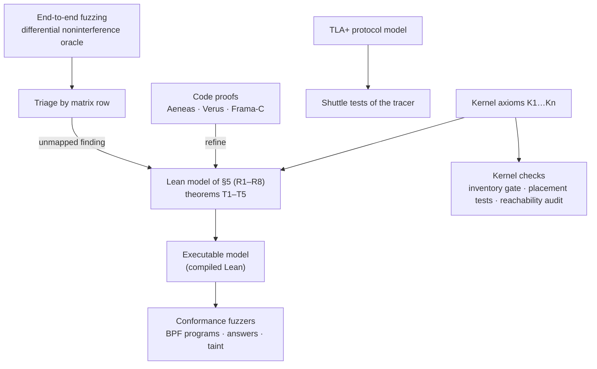

# Verification plan for privileged enforcement

Status: **plan**. It covers what [`threat-model.md`](threat-model.md) asks of privileged
enforcement and how to establish it with as little left to human review as possible.

## 1. Goal

A reviewer should not have to read the implementation to trust it. Every claim is either proved,
model-checked, or checked mechanically against a proved model; what remains for people is a short
list of *statements*: the model, the kernel assumptions, the specifications the proofs establish,
and the oracle the fuzzers trust (§10).

Each component ends in one of four states:

| State | Meaning | Human reads |
|---|---|---|
| **Proved** | A machine-checked proof that the code meets its specification | The specification |
| **Model-checked** | A protocol model checked exhaustively, and the code tested against its invariants | The model's invariants |
| **Conformant** | Unproved code driven against an executable, proved model; any divergence fails | Nothing beyond the model |
| **Audited** | Small trusted glue that no tool reaches | The code itself |

## 2. Scope

Primary: Zak Kent's work, commits `4ed3246`..`bf37abb` in this repository (24 commits, about 11,200
added lines of non-test code and 7,300 of tests), the uncommitted threat-model phase 2 (about 800),
and `2d72d21`, `576be58` in junco-policy (`TracePolicy`, the incremental `TraceCursor`, about 480).
Secondary: the parts of the tracer and shell those changes rely on.

Only privileged mode is in scope; the unprivileged mode is best effort by the threat model's own
terms (§1). Claims are verified only for what the implementation covers at phase 2: matrix rows 1,
7, 11 and 18, the phase-1 mechanisms of rows 9, 12, 13 and 15, and row 5's kernel socket taint.
The rest are carried as explicit, machine-tracked gaps (§4.2).

| Component | Where | Size | Nature | Target state |
|---|---|---|---|---|
| Peer and file classification | `marsh-peer-class` (`lib.rs`, `file_class.rs`) | 600 | Pure, safe Rust | Proved |
| Kernel-shared C | `marsh-bpf/src/marsh.h`, `classify.c` | 250 | Pure C | Proved |
| Rule compiler | `marsh-core/src/shell/agent/files.rs` | 280 | Pure except anchor lookup | Proved |
| Policy vocabulary | `marsh-core/src/shell/agent.rs` | 1,350 | Builds junco rules | Proved (rule denotations) |
| Incremental trace cursor | junco-policy `policy/trace.rs`, `evaluate.rs` | 500 | Pure; arena and self-referential cell | Proved, else Conformant |
| Kernel answers | `marsh-core/src/shell/answers.rs` | 570 | Pure core behind a mutex | Proved (core) |
| Taint table | `marsh-core/src/shell/taint.rs` | 240 | Pure data structure | Proved |
| BPF programs | `marsh-bpf/src/marsh.bpf.c` | 1,540 | Kernel, concurrent | Conformant (+ verifier memory safety) |
| Loader | `marsh-bpf/src/lib.rs` | 720 | `unsafe` syscalls, fail-closed state | Conformant + Audited |
| Tracer kernel side | `marsh-instrument/src/tracing_kernel.rs`, `tracing.rs` | 850 + parts | Threads, ptrace | Model-checked |
| Launch confinement | `marsh-instrument/src/confine.rs`, `enforcement.rs` | 710 | `unsafe`, kernel APIs | Conformant + Audited |
| Socket/local helpers | `local.rs`, `socket.rs`, `capture.rs`, `observation.rs` | 1,000 | `/proc` and ptrace parsing | Conformant |
| Shell integration | `snapshot.rs`, `session.rs`, `mod.rs`, `policy.rs`, `access.rs` | 3,400 | Stateful glue | Conformant |
| Interpreter seam | `brush-core/src/hostfs.rs` | 140 | Routing | Mechanically checked (§9) |
| rmux environment | `rmux-server/src/agent_env.rs` | 240 | Configuration parsing | Property-tested |
| Leak harness | `marsh-core/src/shell/tests/leak_fuzz/` | 1,800 | Test oracle | Audited (oracle only) |

## 3. Architecture

One specification is shared by every layer: the Lean model. Proofs refine it, conformance fuzzers
execute it, and the end-to-end oracle checks its main theorem empirically. Kernel assumptions
enter only as named axioms, each with its own mechanical check.

## 4. Layer 1: the formal model

### 4.1 Contents

A Lean 4 project, `verification/lean/`:

* **State:** domains with principals and labels; objects (inodes with name, parent and label,
  sockets with owner, traced flag and tags, pipes, mappings); the untraced world U; per-root
  answers (`deny`, `guarded`, `carried`, `contingent`, `acknowledged`, `stale`) and receipt
  counters; the poison flag.
* **Operations:** one per mediated kernel effect (create, link, rename, evict and reload, read,
  map, exec, write, connect, send, receive, fork, publish answers, fold receipts, declassify), plus
  an `unmediated` operation for each channel-matrix row not yet implemented.
* **Rules:** R1–R8 as the transition relation, including the userspace steps (receipts folded,
  answers republished) that run concurrently with the kernel's.
* **Observation:** `U`'s projection: packets to each peer class, content and metadata U can read,
  and what other principals' domains can read.

### 4.2 Theorems

| | Statement | Threat-model goal |
|---|---|---|
| **T1** | Noninterference: two states that differ only in the contents of objects of class *c* produce equal U-projections under every adversary schedule of implemented operations, for any principal the policy forbids to hold *c* | G1–G3 |
| **T2** | Egress: no contact of a forbidden peer class is permitted while a domain holds or has a pending receipt of the class, including between a receipt and its fold (the contingent answers) | G1, R5 |
| **T3** | Fail-closed: from any state with poison set, or with a full map, every guarded contact is refused | G5 |
| **T4** | Classification: the label the kernel computes for any path, across creation, rename, link and eviction, includes every propagated class the policy's first-match labelling gives it | R1 |
| **T5** | Escape: no implemented operation by a governed task changes its identity, capabilities, namespaces or cgroup, or writes outside its writable roots | G4, R7 |

T1 is stated for an adversary restricted to implemented operations. Each `unmediated` row is a
hypothesis the theorem carries, so as phases 3–6 land the restriction shrinks and the remaining
gaps are always the explicit list in the theorem's statement.

### 4.3 Axioms

Every kernel behaviour the model trusts is a named axiom, **K1…Kn**, of the form "operation *o* on
object kind *k* passes hook *h*, with arguments *a*, before its effect is visible", plus BPF and
cgroup facts (inode storage freed with the inode; cgroup membership inherited and not leavable;
`d_instantiate` on every lookup and creation). Each axiom records the Linux v7.0 source location
it rests on and the §7 check that tests it. The axiom list is part of the audit set.

### 4.4 Executable model

Lean 4 compiles. A `marsh-model` binary reads a JSON trace of operations and prints the expected
events, decisions and labels after each. It is the oracle for every conformance fuzzer (§6), so
those fuzzers trust nothing that is not proved.

Effort: 4–8 weeks for the model, T1–T5 and the executable, for someone fluent in Lean.

## 5. Layer 2: code proofs

| Target | Theorem | Tool | Preparation | Effort |
|---|---|---|---|---|
| `builtin_class`, `Endpoint::normalize`, `effective_networks` | Equal to the model's peer classifier; overlapping declarations resolve by first declaration under longest-prefix match | Aeneas → Lean | `#![forbid(unsafe_code)]` | 1–2 weeks |
| `NameRule::matches`, `InodeLabel::child`, `NameRule::join` | Equal to the model's glob subset and classification step; `join` preserves every rule's matches | Aeneas → Lean | none | 1 week |
| Rule compiler (`agent/files.rs`) | T4's compile half: for every pattern of a propagated class that compiles, every path it matches is labelled with its class from any anchor; uncompilable patterns are refused | Aeneas → Lean | Split into a pure `compile` taking anchor existence as an input; scope registry passed in | 2–4 weeks |
| Glob specification | The Lean glob subset agrees with the `glob` crate under `MATCH` | Differential test against the executable spec | — | days |
| `marsh.h` (`marsh_name_matches`, `marsh_inherit`, `marsh_apply_rule`, classifier, normalisation) | ACSL contracts transliterating the Lean definitions; proved with Frama-C WP | Frama-C | none | 1–2 weeks |
| C/Rust equivalence | Exhaustive within bounds: every name up to 6 bytes over a 4-letter alphabet against every rule shape with prefix and suffix up to 3, and every IPv4 address against a fixed network set | `cargo test` | none | days |
| `TraceCursor` | After any sequence of `extend` and `restart`, the cursor's verdicts equal batch evaluation of the whole trace | Aeneas if the arena and `self_cell` translate; else Verus on an extracted core | 3-day spike first | 4–12 weeks |
| Policy vocabulary | Each builder's rules denote its documented property in junco's semantics (for example, `no_contact_after_read`: a contact of a listed peer class is denied iff an undeclassified read or taint of the class precedes it) | Lean over the junco semantics | Lean semantics of junco rules, checked against junco by differential test | 3–6 weeks |
| `KernelAnswers::refresh` core | T2's userspace half: `contingent[i]` is the decision after appending taint *i*; `deny` equals the decision from scratch; the generation only advances | Aeneas → Lean | Extract the pure decision function from the mutex and `TAINTS` registry | 2–3 weeks |
| `TaintState` | Labels only grow except by `declassify`; `received` excludes a principal's own reads; carriers transfer at the next read | Aeneas, or Verus with `vstd` maps if `BTreeMap` lacks a model | none | 1–2 weeks |

Aeneas keeps proofs out of the code: the Rust stays as written and the theorems live beside the
model. Verus is the fallback where Aeneas's supported subset (safe, sequential Rust and a partial
standard-library model) is too narrow. Kani bounded proofs cover panic and overflow freedom of the
parsers (`Endpoint::from_sockaddr`, `NameRule::new`) at little cost.

## 6. Layer 3: conformance for unproved code

### 6.1 BPF programs

A model-based fuzzer extends `crates/marsh-bpf/tests/lsm.rs`. It generates operation sequences
over a small universe (two domains and U, a few names, sockets and files), including evictions
(`drop_caches`), renames, links, exchanges, races across threads, answers published at random
points and receipts folded late. Each operation runs in the guest. After each step it compares
the drained events, the decisions and a dump of the maps (`INODES` through `Controller::label`
lookups, `RETAINED`, `FLOWS`, `RECEIVED`, `HEALTH`) with `marsh-model`. A divergence shrinks to a
minimal sequence.

* **Fault injection:** a test build with tiny `RETAINED`, `FLOWS`, `KEYS` and ring sizes, and an
  allocation-failure switch for inode storage, checks T3: every exhausted resource poisons.
* **Memory safety:** the kernel's BPF verifier, run on every load, already proves it; CI loads
  the programs in the guest on every change.

### 6.2 Tracer and event protocol

A TLA+ model of the kernel-event protocol: drain under the state lock, reservation of runs,
delivery, release, quiescence, the stale switch and publication generations. TLC checks:

* no drained event is lost without the service failing;
* no run's evidence is published while a delivery for it is pending;
* answers in force never go back a generation;
* a stale root's guarded contacts are refused until its answers are republished.

The same invariants become assertions in `shuttle` randomized-schedule tests of
`tracing_kernel.rs`.

### 6.3 Launch confinement

A guest test introspects a confined command after `restrict_child`: uid and gid, every capability
set empty, `NoNewPrivs`, cgroup, namespace inode numbers, the session keyring, and Landlock
(probing writes outside and inside the writable roots). Together with the escape tests (`lsm`
`escapes_are_refused_in_a_domain`, corpus `control-privilege-boundary`) this is T5's evidence for
code the model does not reach.

### 6.4 Shell integration

`snapshot.rs`, `session.rs` and `answers.rs`'s callers are exercised through the leak corpus and
the existing differential test `kernel_answers_stay_equal_to_fresh_and_lazy_decisions_as_the_command_runs`,
whose reference becomes `marsh-model`.

## 7. Layer 4: kernel assumptions and model completeness

* **Inventory gate (threat-model §8.7):** a machine-readable Appendix A,
  `crates/marsh-bpf/hooks.toml`, maps each hook to its disposition and matrix row. At load the
  controller lists the running kernel's `bpf_lsm_*` BTF functions and refuses privileged startup on
  any hook the file does not classify. CI runs the same check against every supported kernel's BTF.
* **Placement tests:** for each axiom, a generated `lsm` test drives every syscall path to its
  effect and asserts the hook's outcome. For example, K-read covers `read`, `pread64`, `readv`,
  `preadv2`, io_uring `READ`, `READV` and `READ_FIXED`, `splice`, `sendfile`, `copy_file_range`,
  `mmap` and `execve`, each required to produce the receipt.
* **Reachability audit:** during fuzzing, fentry probes on every `security_*` function and the
  syscall exit of governed tasks record (syscall, hooks passed, object kind) triples. A triple
  whose effect reaches shared state without passing a hook marked T, E, B or D in Appendix A is a
  candidate gap in the model.
* **Shared-resource matrix:** a machine-readable list of kernel object kinds, each with who can
  write it and who can read it. CI checks that every (governed writer, U or other-domain reader)
  pair names a matrix row, and every matrix row names an axiom.
* **Kernel drift:** CI regenerates Appendix B from each new kernel tag's `lsm_hook_defs.h` and
  fails on unclassified hooks.

## 8. Layer 5: end-to-end adversarial fuzzing

### 8.1 Oracle

Differential noninterference: each program runs twice with secrets that differ, and the
U-projections are compared after normalising run-specific names. Any difference is a leak
whatever the encoding.

**Implemented** in `leak_fuzz/projection.rs` for every attack case. The twins use independent
canaries, which differ in nearly every bit, so a leak of any part of the secret shows; a
one-bit pair only proves sensitivity to that bit. The projection is what the harness, as an
untraced observer, can read: the bytes each sink received (by listener and sender address), and
the change across the steps in files under `/tmp`, `/var/tmp`, `/dev/shm` and `/dev/mqueue`
outside the fixture's governed state, listening TCP and bound UDP ports, bound UNIX socket names
(abstract included), other processes' names and arguments, `/proc/keys`, and System V IPC
objects. The fixture's path and the sinks' ports are normalised; pids, inode numbers, times and
client ports are never recorded. Controls and the audit replay keep the encoding search of
`oracle.rs`: they must prove delivery, not its absence.

Not yet in the projection: packets on an egress interface other than the sinks (the namespace has
only loopback, so every external peer is a sink), other domains' views, and timing.

### 8.2 Generators

| Generator | Purpose |
|---|---|
| Semantic mutation of corpus cases: transport, process structure, encoding, timing, eviction pressure | Variants of known holes |
| In-domain syscall fuzzing: syzkaller descriptions, an executor that reads the secret and then runs a random program, inside a governed domain | Unknown channels |
| LLM red team: an agent given the policy and threat model and told to exfiltrate | Realistic multi-step attacks |
| Published suites (SABER, arXiv 2606.01317; RedCode, arXiv 2411.07781) | Seeds |

Feedback: coverage of security hooks reached by governed tasks, and per-branch counters in the
BPF programs exposed through a map in a test build.

### 8.3 Triage

Every finding is mapped to a matrix row. A known gap row goes to the per-row expected-gap
registry; a bug in an implemented row becomes a corpus case and a model or conformance test; a
finding that maps to no row means the model is incomplete, and the threat model is extended
before the fix.

### 8.4 Infrastructure

The disposable guest currently runs under TCG: the corpus takes about 15 minutes per mode.
Fuzzing needs KVM hosts, several guests in parallel and snapshot resets between programs. CI
tiers: pull requests run the corpus with one seed in both modes; nightly runs mutations and the
BPF conformance fuzzer; weekly runs syscall fuzzing for 24 hours and a red-team session.

## 9. Mechanical checks (first, cheap)

* `#![forbid(unsafe_code)]` on `marsh-peer-class` and on the extracted pure cores.
* Clippy `disallowed-methods` in `brush-core` forbidding direct filesystem calls outside
  `hostfs.rs`, so the interpreter seam (matrix row 18) is complete by construction.
* An `unsafe` inventory gate: a CI check that lists every `unsafe` block in the diff's crates and
  fails on additions not in the audit set (§10).
* Miri on the pure crates' tests; ASan on `classify.c` and the parity tests.
* Clippy clean on every crate in scope: `marsh-peer-class`, `marsh-bpf`, `marsh-instrument` and
  `marsh-core` pass `cargo clippy --all-targets` with and without the `privileged` features; a
  CI job running both is still to be added.

## 10. What remains for human review

| Item | Approximate size |
|---|---|
| Lean model definitions and the statements of T1–T5 | 600–900 lines |
| Kernel axioms K1…Kn with source citations | 40–60 entries |
| Shared-resource matrix and `hooks.toml` (the Appendix A data) | checked mechanically for coverage; read for correctness |
| Statements of the code-proof theorems (§5) and the ACSL contracts | 200–300 lines |
| TLA+ invariants (§6.2) | 50 lines |
| Differential oracle and U-projection capture | 300–400 lines |
| Audited `unsafe` blocks (loader syscalls, confinement, socket helpers) | about 30 blocks |

That is roughly 1,500–2,000 lines of statements, against about 12,000 lines of non-test code in
scope, and none of it is implementation logic except the `unsafe` blocks.

## 11. Phases

| Phase | Work | Exit criterion |
|---|---|---|
| **V0** (2 weeks) | §12 fixes; §9 checks; inventory gate; differential oracle; exhaustive C/Rust equivalence; Kani harnesses | Gates in CI, corpus green under the new oracle |
| **V1** (6–8 weeks) | Lean model, T1–T5, executable model; BPF conformance fuzzer and fault injection | T1–T5 proved for phase-2 rows; fuzzer finds no divergence in a week of runs |
| **V2** (4–6 weeks) | Aeneas proofs for classification, the compiler and the glob specification; Frama-C for `marsh.h` | §5 rows 1–6 proved |
| **V3** (6–12 weeks) | `TraceCursor` spike then proof; answers and taint cores; policy vocabulary denotations; TLA+ and shuttle tests | §5 complete; protocol invariants model-checked |
| **V4** (ongoing) | Placement tests per axiom; reachability audit; syscall fuzzing; red team | Every axiom has a passing placement test; no unmapped finding |

Each threat-model phase (3–6) that lands extends the model's implemented operations, adds its
axioms and placement tests, and moves its rows out of T1's hypotheses.

## 12. Known issues (resolved)

1. **Silent loss of the event thread.** A drain or attribution error (for example "kernel event
   has no live trace run") returned without failing the service, so the event thread exited and
   the ring stopped draining. Every error in `deliver_kernel_events` now fails the service while
   the batch's records are still held (`undeliverable_kernel_events_fail_the_service`).
2. **A ptrace ordering window.** The A/B leak of `untraced-local-daemon-exfil` with file
   classification off did not recur in ten further runs under the real runner. The suspected
   window exists elsewhere: the tracer orders a new task's records after the call that created
   it, and the gate judged contacts without them. A child of `clone(CLONE_VFORK)`, whose parent
   cannot return before it exits, read a secret and sent it in both modes
   (`vfork-child-read-exfil` unprivileged; `vfork-child-staged-exfil`, a ptrace-only carrier, in
   both). While a root has unordered records its answers are now published stale and the ptrace
   gate refuses every contact the policy judges; both cases are blocked in both modes.
3. **Clippy failures**: fixed (§9).
